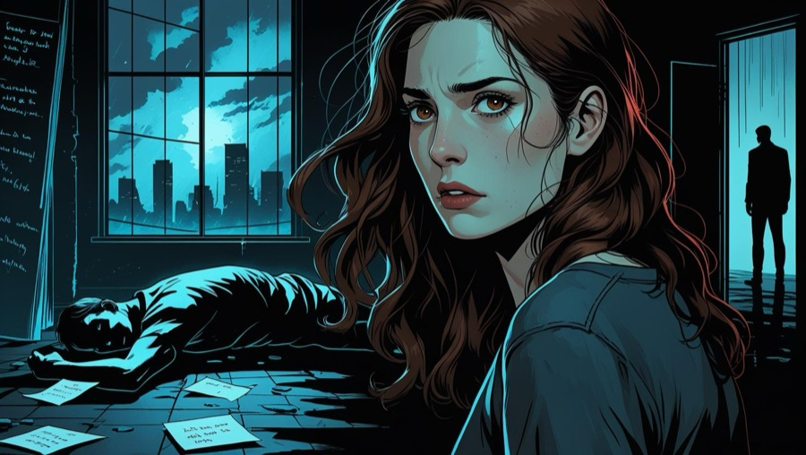
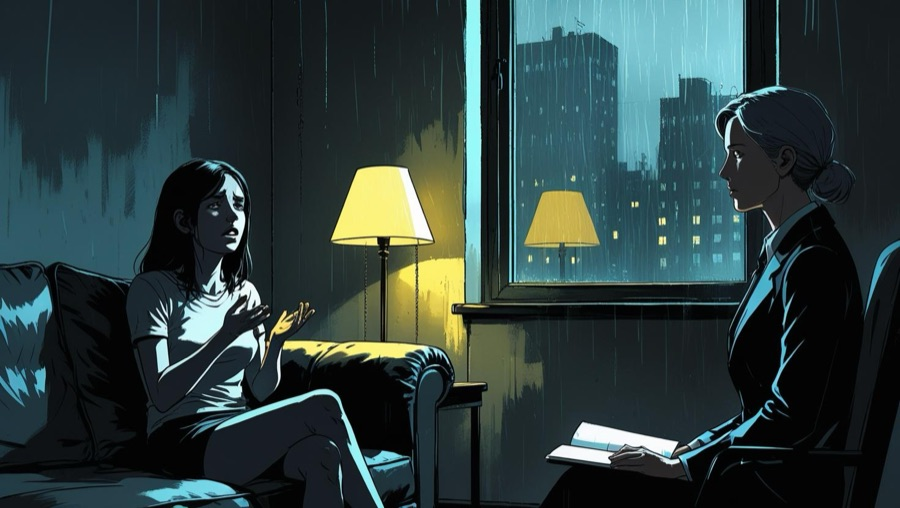
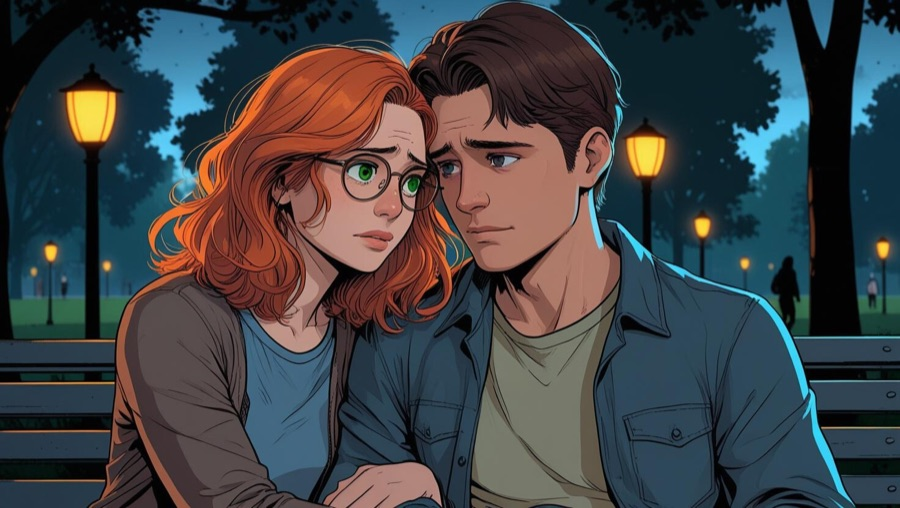

# Deadly Dream

**A comic-style murder mystery for iPhone, built in SwiftUI.**
Read the story panel by panel, question the suspects, keep notes, and work out who the killer is.

| | |
|---|---|
|  |  |
|  | *Deadly Dream* (Turkish title: *Ölümcül Rüya*) is a Turkish-language story in 7 sections. The art is generated, the writing and the game are ours. |

## How it plays

1. **Intro.** A full-screen opening with narration and theme music.
2. **Story.** Tap to move through comic-style panels. Dialogue types itself out in a subtitle box at the bottom of the screen.
3. **Interrogation.** Question each suspect and compare what they say.
4. **Notes.** A notebook keeps the clues you have gathered.
5. **Decision** *(in progress)*. Choose who did it; the ending depends on your choice. The culprit and the ending are already in the scenario file, the screens are next.

## Built to be reused

The whole game is data. `story.json` and `interregation.json` describe every section, panel, image, line of dialogue, suspect and the true culprit. A new mystery is a new JSON file and a new set of images, with no code changes.

## Stack

- Swift, SwiftUI, landscape-only iPhone app
- JSON-driven story engine (`Models/StoryModels.swift`, `DialogueModels.swift`, `InterrogationModels.swift`)
- Typewriter text effect and custom button and dialogue styles
- Saira typeface, bundled

## Run

Open `detective.xcodeproj` in Xcode 16+ and run on an iPhone simulator.

---

Made by [Keremcan Şeker](https://github.com/keremcanseker) and [Esma Koçak](https://github.com/esmakocak).
